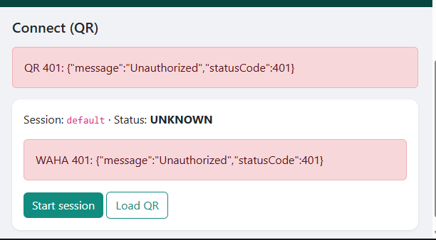
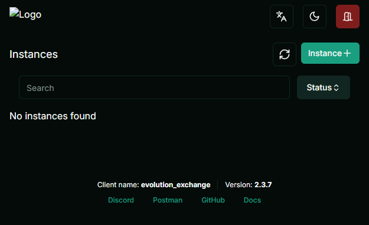

# WAHA vs Evolution API — comparison & recommendation

**Downloads:** [Word (.docx)](./WAHA-vs-Evolution-Comparison.docx) · [PDF](./WAHA-vs-Evolution-Comparison.pdf)  
Regenerate: `python scripts/build_comparison_exports.py` from `poc/`.

Both POCs in this repo share the **same Flask product flow** (login → QR connect → sync contacts → compose/campaign). Only the **WhatsApp engine** behind the API differs.

| Step | Shared Flask flow |
|------|-------------------|
| 1 | Login `admin` / `admin123` |
| 2 | **Connect** — start session/instance, scan QR |
| 3 | **Contacts** — sync from WhatsApp |
| 4 | **Compose** — free-text message |
| 5 | **Campaign** — queue send to selected contacts |

| Folder | Engine | Flask | Engine port |
|--------|--------|-------|-------------|
| `poc/waha-poc/` | [WAHA](https://github.com/devlikeapro/waha) | http://127.0.0.1:5001 | 3000 |
| `poc/evolution-poc/` | [Evolution API](https://github.com/evolution-foundation/evolution-api) | http://127.0.0.1:5002 | 8080 |

Startup details: **[GETTING_STARTED.md](./GETTING_STARTED.md)** · Commands: **[COMMANDS.md](./COMMANDS.md)**

---

## Admin UIs (screenshots)

### WAHA — built-in dashboard

- **URL:** http://127.0.0.1:3000/dashboard/
- **Auth:** Username + password from `waha-env/.env`; link worker with **`WAHA_API_KEY`**

### Evolution — Evolution Manager

- **URL:** http://127.0.0.1:8080/manager
- **Auth:** **Global API key** only (same as `EVOLUTION_API_KEY`)

### Flask demo (identical UX on both POCs)

Same screens on **5001** (WAHA) and **5002** (Evolution): green WhatsApp-style nav, Connect / Contacts / Compose / Campaigns. Use this for **stakeholder demos**; use native UIs for **engine debugging**.

---

## Side-by-side comparison

| Criteria | WAHA | Evolution API |
|----------|------|----------------|
| **Docker footprint** | **1 container** (WAHA only) | **3 containers** (API + Postgres + Redis) |
| **First-time setup** | Run `init-waha.bat`, sync API key to Flask `.env` | Set matching API key in compose + `.env`; longer first pull |
| **Admin login** | Username + password + API key for worker | API key only on Manager |
| **Session model** | Named **sessions** (`default`) | Named **instances** (`default`) |
| **QR connect** | Works; watch for **422** if QR loaded while status is `STARTING` | Works; must **create/start instance** before connect |
| **Contact sync** | Straightforward GET-style API in our client | v2 requires **POST** `findContacts` with `{"where":{}}` (GET → 404) |
| **API auth header** | `X-Api-Key` | `apikey` |
| **Docs / ecosystem** | Strong docs at [waha.devlike.pro](https://waha.devlike.pro); focused product | Large community; Manager v2; more env/database options |
| **Multi-instance / SaaS** | Supported via sessions + namespace | **Strong fit** — instances DB, Manager UI, Redis cache |
| **Stability in our POC** | Good after key fix; QR timing UX needs polish | Good after contact API fix; heavier stack |
| **Best for bulk on one number** | **Excellent** | **Good** |
| **Best for many WhatsApp numbers** | Good | **Better** |

---

## POC scorecard (filled from our testing)

| Criteria | WAHA | Evolution |
|----------|------|-----------|
| Install time | **~5 min** (after Docker) | **~10–15 min** (DB + Redis + image) |
| QR connected | Yes | Yes |
| Contact sync | Yes | Yes (after POST fix) |
| Single send | Yes | Yes |
| Campaign queue | Yes (same Flask code path) | Yes |
| Stability (short demo) | Stable | Stable |
| Docs / ease for devs | **Easier** (fewer services) | More moving parts |
| Native admin UX | Workers/sessions dashboard | **Polished Manager** (instances) |
| **Pick for this product** | **Recommended** | Strong alternate |

---

## Legal & operations (both)

- Uses **WhatsApp Web / Baileys-class** linking — **not** the official **Meta Cloud API**.
- No Meta template approval path; free-text is possible but **policy and ban risk** still apply.
- Use a **dedicated test number**, rate limits, and **opt-in/consent** for marketing.
- For **compliance-first** production, keep evaluating **`legacy-cloud-api/`** (Cloud API) separately.

---

## Recommendation: what should we use?

### Primary choice for this project: **WAHA**

For the goal you validated in these POCs — **one web app, one WhatsApp number, QR login, contact sync, bulk/campaign sends** — **WAHA is the better default engine**:

1. **Simpler operations** — one Docker service, no Postgres/Redis to maintain on a laptop or small VPS.
2. **Faster onboarding** — `init-waha.bat` + one API key to copy; clear **401** story when keys mismatch.
3. **Enough admin UI** — dashboard + Swagger for support staff without running a separate Manager stack.
4. **POC friction was lower** after credentials were fixed (Evolution needed instance lifecycle + contact API version quirks).

**Ship path:** Keep `poc/waha-poc/` as the template; port its `waha_client` + connect/contact flow into a single product repo; retire duplicate Evolution client or keep it behind a feature flag only if stakeholders require Evolution-specific integrations.

### When to choose **Evolution** instead

Pick Evolution if product requirements shift to:

- **Many WhatsApp instances** (multi-tenant, per-customer numbers) with **Manager** as the ops console
- Existing team already on **Evolution** webhooks, Postgres-backed instances, or host **`evoapicloud`** images in production
- Need ecosystem integrations Evolution documents heavily (chatbots, n8n, etc.) that you do not want to rebuild on WAHA

### What we should **not** rely on for “CEO QR + scrape all contacts” alone

Neither engine is a substitute for **Meta-approved** messaging at scale. If leadership needs **official** WhatsApp Business + templates + lower ban risk, plan a **Cloud API** track (`legacy-cloud-api/`) for sends and **Google Contacts OAuth** (or CSV upload) for audience — not WhatsApp contact export as the only source.

---

## Decision summary

| Question | Answer |
|----------|--------|
| Which engine for v1 product? | **WAHA** |
| Which Flask POC to demo first? | **http://127.0.0.1:5001** |
| Keep Evolution POC? | Yes — reference & multi-instance evaluation |
| Official Meta path? | Separate decision; see `legacy-cloud-api/` |

---

## Next steps (optional)

1. Merge one Flask app + configurable engine (`WAHA` / `EVOLUTION` / `MOCK`).
2. Improve Connect page: poll until QR-ready (fix WAHA 422 UX).
3. Stakeholder sign-off using this doc + live demo on **5001**.
4. Production hardening: rotate API keys, HTTPS reverse proxy, secrets not in git.
