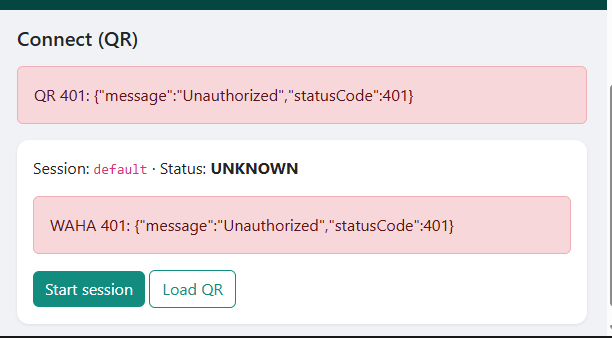
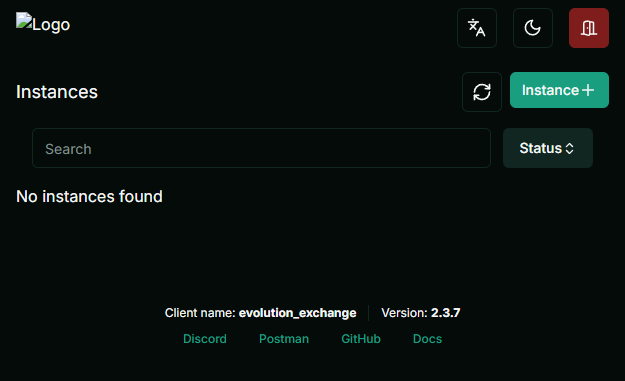

# Starting both POCs — WAHA & Evolution

This guide covers **Docker engines**, **Flask demo apps**, and **native admin UIs** for both stacks. Run them on the same machine; they use **different ports** so both can run together.

**Prerequisites:** [Docker Desktop](https://www.docker.com/products/docker-desktop/) running, Python 3.11+ with `pip`.

---

## Quick reference

| What | WAHA stack | Evolution stack |
|------|------------|-----------------|
| **Engine (Docker)** | `http://127.0.0.1:3000` | `http://127.0.0.1:8080` |
| **Native admin UI** | [WAHA Dashboard](http://127.0.0.1:3000/dashboard/) | [Evolution Manager](http://127.0.0.1:8080/manager) |
| **Flask demo app** | [http://127.0.0.1:5001](http://127.0.0.1:5001) | [http://127.0.0.1:5002](http://127.0.0.1:5002) |
| **Flask login** | `admin` / `admin123` | `admin` / `admin123` |
| **Project folder** | `poc/waha-poc/` | `poc/evolution-poc/` |

---

## Part A — WAHA

### A1. One-time: generate API keys

From `poc/waha-poc/`:

```bat
init-waha.bat
```

This writes **`waha-env/.env`** with:

- `WAHA_API_KEY`
- `WAHA_DASHBOARD_USERNAME` (default `admin`)
- `WAHA_DASHBOARD_PASSWORD` (random hex — **your password**)

Copy **`WAHA_API_KEY`** into **`poc/waha-poc/.env`** (Flask must use the same key):

```env
WAHA_API_KEY=<same as waha-env/.env>
```

### A2. Start WAHA (Docker)

```bat
cd poc\waha-poc
docker compose up -d
```

**Check engine is up:**

```powershell
curl.exe -H "X-Api-Key: YOUR_WAHA_API_KEY" http://127.0.0.1:3000/api/sessions
```

Expect **HTTP 200** and JSON (not 401).

### A3. Start Flask (demo UI)

```bat
cd poc\waha-poc
copy .env.example .env
pip install -r requirements.txt
python app.py
```

Open **http://127.0.0.1:5001** → login **`admin` / `admin123`**.

### A4. WAHA native dashboard

| Item | Value |
|------|--------|
| **URL** | http://127.0.0.1:3000/dashboard/ |
| **Username** | `WAHA_DASHBOARD_USERNAME` in `waha-env/.env` (usually `admin`) |
| **Password** | `WAHA_DASHBOARD_PASSWORD` in `waha-env/.env` |
| **Worker API key** | Same as `WAHA_API_KEY` in `waha-env/.env` |

After login, in **Workers**: edit the worker row (pencil) or **Connect** → set URL **`http://127.0.0.1:3000`** and paste **`WAHA_API_KEY`**. Red X icons should turn green.

Swagger (optional): http://127.0.0.1:3000/ — same dashboard username/password.



### A5. Demo flow (Flask app)

1. **Connect QR** → **Start session** → wait until status allows QR → **Load QR** → scan on phone.  
   - If **422**: session still `STARTING`; wait, refresh, or **Disconnect** → **Start** again.
2. **Contacts** → **Sync from WhatsApp**
3. **Compose** / **Campaigns** → send test messages

**Disconnect / reset:** Connect page → **Disconnect WhatsApp**; Contacts → **Clear local cache** (SQLite on laptop only).

### A6. Mock mode (no Docker)

In `poc/waha-poc/.env`: `ENGINE_MOCK=true` → run `python app.py` only.

---

## Part B — Evolution API

### B1. Configure API key

Default in **`docker-compose.yml`** and **`.env`**:

```env
EVOLUTION_API_KEY=change-me-evolution-api-key
```

`AUTHENTICATION_API_KEY` in compose and `EVOLUTION_API_KEY` in Flask **must match**. Change both if you harden production.

### B2. Start Evolution (Docker)

```bat
cd poc\evolution-poc
docker compose up -d
```

First pull can take several minutes (Postgres + Redis + API).

**Check engine:**

```powershell
curl.exe -H "apikey: change-me-evolution-api-key" http://127.0.0.1:8080/
```

Expect JSON with `"message": "Welcome to the Evolution API..."` and a `"manager"` URL.

### B3. Start Flask (demo UI)

```bat
cd poc\evolution-poc
copy .env.example .env
pip install -r requirements.txt
python app.py
```

Open **http://127.0.0.1:5002** → **`admin` / `admin123`**.

### B4. Evolution Manager (native UI)

| Item | Value |
|------|--------|
| **URL** | http://127.0.0.1:8080/manager |
| **Login** | **API Key Global** only (no username) |
| **Key** | Same as `EVOLUTION_API_KEY` / `AUTHENTICATION_API_KEY` |
| **Server URL** | `http://127.0.0.1:8080` |




### B5. Demo flow (Flask app)

1. **Connect QR** → **Start session** (creates instance `default` if missing) → **Load QR** → scan.
2. **Contacts** → **Sync from WhatsApp** (uses Evolution v2 **POST** `/chat/findContacts/{instance}`).
3. **Compose** / **Campaigns**

Instance name defaults to **`default`** (`EVOLUTION_INSTANCE` in `.env`). Use the same name in Manager if you create instances there.

### B6. Mock mode

In `poc/evolution-poc/.env`: `ENGINE_MOCK=true`.

---

## Running both at once

| Service | Port |
|---------|------|
| WAHA | 3000 |
| Evolution API | 8080 |
| Flask WAHA POC | 5001 |
| Flask Evolution POC | 5002 |

Start both `docker compose` stacks, then two terminals with `python app.py` in each folder.

---

## Where to check what

| Symptom | WAHA | Evolution |
|---------|------|-----------|
| Engine down | `docker compose ps` in `waha-poc` | `docker compose ps` in `evolution-poc` |
| Auth failed | Flask `.env` key ≠ `waha-env/.env` | Flask `.env` key ≠ compose `AUTHENTICATION_API_KEY` |
| QR issues | Session status on Connect page; WAHA dashboard **Sessions** | **Start session** first; Manager **Instances** |
| Contacts empty | WhatsApp linked? Sync after **open** state | Instance connected? Sync after link |
| Logs | `docker compose logs -f waha` | `docker compose logs -f evolution-api` |

---

## Security notes

- Do **not** commit `waha-env/.env`, `poc/waha-poc/.env`, or `poc/evolution-poc/.env` with real keys.
- Re-running **`init-waha.bat`** generates **new** WAHA keys; update Flask `.env` and restart Docker.
- Both engines use **WhatsApp Web (unofficial)** — not Meta Cloud API. Use a **test number**; bulk sends can trigger restrictions.

---

## Related docs

- [WAHA vs Evolution comparison & recommendation](./COMPARISON.md)
- [waha-poc/README.md](./waha-poc/README.md)
- [evolution-poc/README.md](./evolution-poc/README.md)
